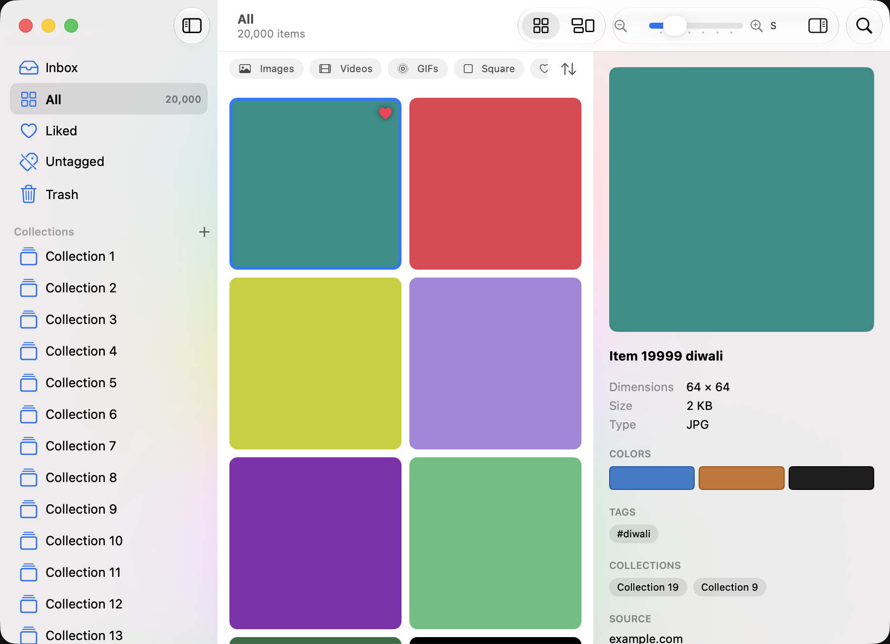

# Grails

A shared picture library for a Mac team: a native app, your own storage, no Grails account.



## What it does

- **Boards in.** Paste an Are.na, Pinterest or X board link and each board becomes a collection.
- **Fast grid** (square or masonry) that stays smooth past 20,000 items. Pinch or ⌘-scroll to zoom, Space to preview.
- **Infinite canvas** next to the grid (⌘2): arrange items freely, per collection or tag.
- **Find it again.** Tags, collections, smart folders, full-text search, ⌘K palette, search by colour, Find Similar.
- **On-device smarts.** Auto-tags, text in pictures and colours are worked out on the Mac. Nothing is uploaded.
- **Capture** by paste, drag and drop, the menu bar, or the Save to Grails browser extension.
- **Teams.** Keep a library in your own Cloudflare R2 bucket, with owner, admin and member roles and single-use invites. Or put it in a shared Drive, Dropbox or iCloud folder. An admin adds references to Holy Grail, the set the team keeps.
- **Plain files.** A library is a folder of your files and small JSON sidecars you can open in Finder.

## Install

Download the current release from [grails.arjoon.xyz](https://grails.arjoon.xyz) and drag Grails to Applications. Grails is not notarised yet, so right-click ▸ Open the first time. Requires macOS 14 or later.

## Build from source

```sh
brew install xcodegen
xcodegen
xcodebuild -scheme Grails -destination 'platform=macOS' build CODE_SIGNING_ALLOWED=NO
```

Tests:

```sh
(cd Packages/GrailsKit && swift test)
(cd Packages/GrailsSync && swift test)
(cd Extensions/chrome-tests && node --test *.test.mjs)
Scripts/check-design-rules.sh
```

Package a DMG with `Scripts/make-dmg.sh` (writes `dist/Grails-<version>.dmg`).

## Run your own fork

The official build's site, update feed and bundle id are set in `Config/Base.xcconfig`. To build your own:

1. `cp Config/Local.xcconfig.example Config/Local.xcconfig` (it's gitignored).
2. Set `GRAILS_BUNDLE_PREFIX` to your own reverse-DNS prefix, so your build doesn't share Keychain items or settings with the official app.
3. Either point `GRAILS_SITE_URL` at your own deploy of the invite server, or leave it empty. Empty means invites are shared as long `grails://` links and nothing is sent to a relay.
4. Either set your own Sparkle feed and EdDSA public key, or leave both empty to turn updates off.
5. Run `xcodegen` and build.

## Repository layout

```
Apps/            the macOS app, the grails CLI, UI tests
Packages/        GrailsKit (library, index, capture, design system), GrailsSync (bucket sync, invites),
                 GrailsEndpoints (the site URL)
Extensions/      the browser extension, its tests and an end-to-end harness
Config/          Info.plist, Base.xcconfig, Local.xcconfig.example
Scripts/         build, test, packaging and release tools
docs/            architecture, design system, team guides, design proofs
```

## How it works

- [docs/ARCHITECTURE.md](docs/ARCHITECTURE.md): packages, the library format, sync, invites, search
- [SECURITY.md](SECURITY.md): threat model, what the invite relay sees, how to report a problem
- [docs/DESIGN_SYSTEM.md](docs/DESIGN_SYSTEM.md): tokens, components and UI rules
- [docs/TEAM_SETUP.md](docs/TEAM_SETUP.md) and [docs/COLLAB.md](docs/COLLAB.md): sharing a library

## Contributing

See [CONTRIBUTING.md](CONTRIBUTING.md).

## Licence

MIT, see [LICENSE](LICENSE). The bundled fonts are under the SIL Open Font Licence and the paintings are public domain; see the `NOTICE.md` files next to them.
